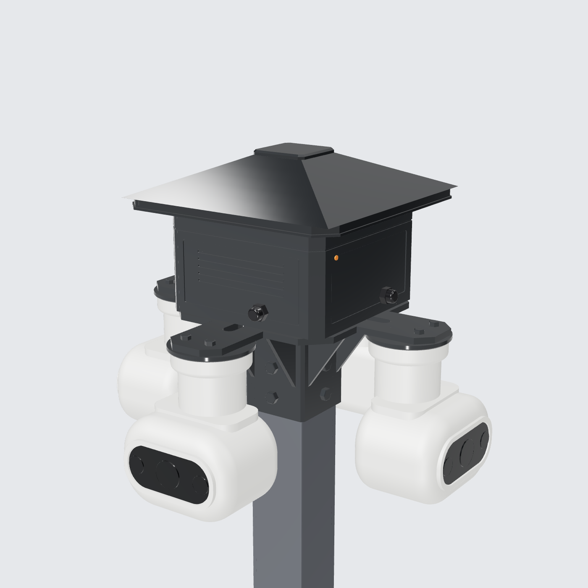
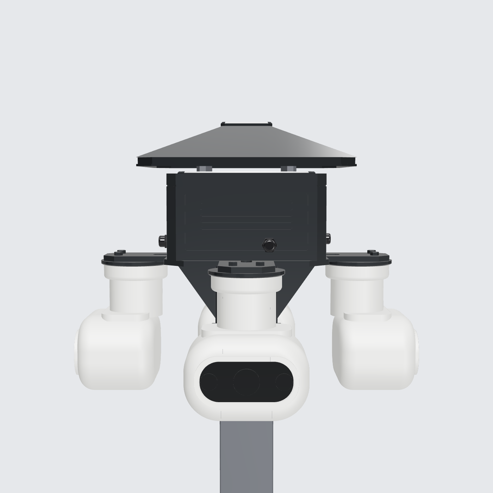
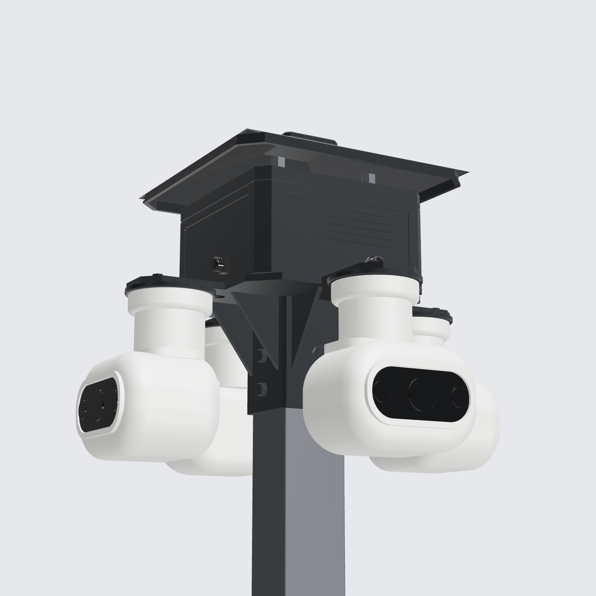
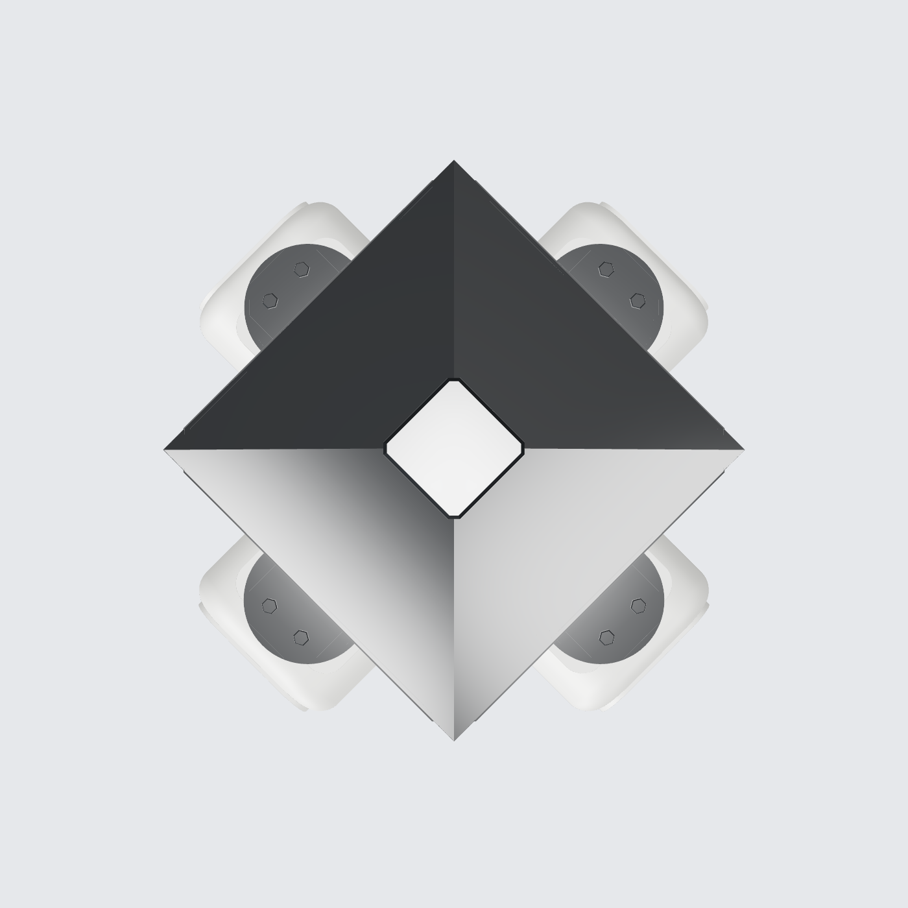
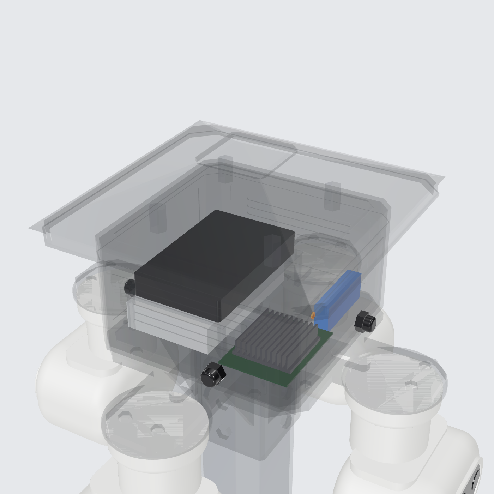

# Kepala Tiang CCTV: 4× Hikvision DS-2DE2C400MWG-E

Model 3D parametrik (CadQuery, solid B-rep, **tanpa mesh**). File STEP bisa langsung dibuka di Fusion 360, FreeCAD, SolidWorks, atau Onshape.



| Depan | Bawah | Atas | Isi box |
|---|---|---|---|
|  |  |  |  |

## File

| File | Isi |
|---|---|
| `cctv_pole_head.py` | Sumber parametrik. Semua dimensi ada di bagian `Parameters` |
| `out/cctv_pole_head_assembly.step` | Assembly lengkap, sudah berwarna |
| `out/parts/*.step` | Part fabrikasi: sleeve, spider plate, controller box, atap, envelope kamera |
| `renders/` | Gambar preview |

Untuk generate ulang:

```bash
pip install cadquery
python cctv_pole_head.py
```

## Susunan (dari atas ke bawah)

1. **Atap anti air**: atap limas 300×300 mm dari plat 3 mm, dengan skirt tetes air (drip skirt) dan bibir tetes. Overhang 37 mm tiap sisi melewati box. Dipasang pada 4 standoff dengan celah udara 10 mm supaya panas dari tutup box bisa keluar.
2. **Box controller**: 226×226×122 mm, dinding 3 mm, sudut vertikal di-chamfer 14 mm. Ada garis split tutup, panel inset, alur louver dekoratif yang tidak tembus (box tetap tertutup rapat, target IP65), LED status amber, dan 4 cable gland PG9 (satu per kamera).
   - **Isi box:** PSU 12 V 10 A (envelope 159×97×30, kelas Mean Well LRS-150-12), Orange Pi 5 Plus dengan standoff dan heatsink, switch gigabit 8 port (envelope 158×101×25) di rak di atas PSU, serta terminal block/fuse.
3. **Spider plate**: plat 8 mm dengan 4 lengan simetris (90°), slot peringan, 8 gusset di bawah lengan, pad adaptor kamera Ø104 mm, dan lubang kabel di tengah yang turun ke dalam tiang.
4. **Sleeve tiang**: tabung kotak untuk tiang 80×80 mm, dikunci 8 baut M10 (2 per sisi).
5. **4 kamera**: masing-masing menggantung di ujung lengan, di radius 168 mm dari sumbu tiang, menghadap ke 4 sisi.

Ukuran keseluruhan kepala: **504 × 504 mm**. Tinggi 226 mm di atas ujung tiang dan 172 mm di bawahnya.

Warna rancangan: graphite matte (sekitar RAL 7021) dan gunmetal untuk aksen logam. Satu-satunya warna terang adalah LED status kecil.

## Catatan

- Kamera di-model sebagai **envelope** sesuai ukuran datasheet (163.9 × 185.8 × 131.9 mm, 600 g), bukan replika bentuk aslinya. Fungsinya untuk cek clearance dan proporsi.
- Envelope switch memakai ukuran desktop 8 port yang umum. Kalau pakai switch PoE atau industrial DIN, ganti `SWITCH` di parameter.
- Kamera ini memakai 12 VDC atau PoE. Di desain ini kamera diasumsikan dapat daya 12 V dari PSU lewat terminal block, jadi switch-nya tidak perlu PoE.
