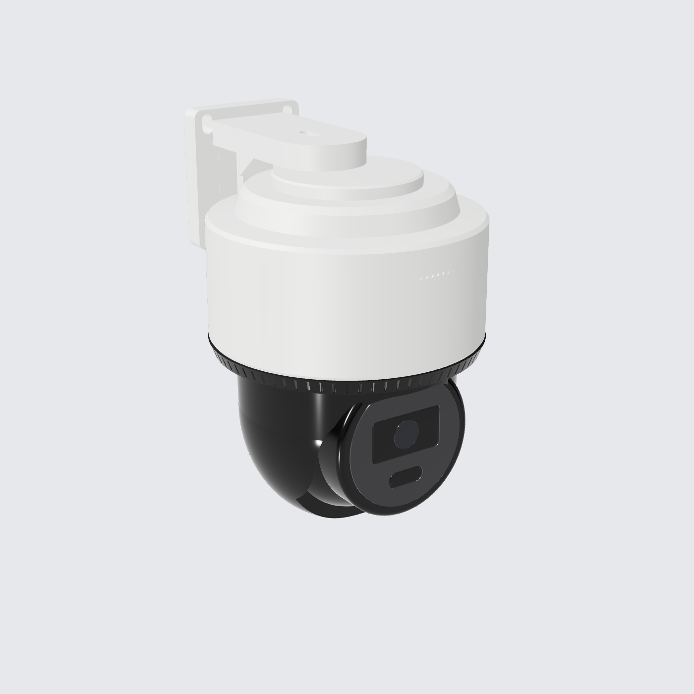
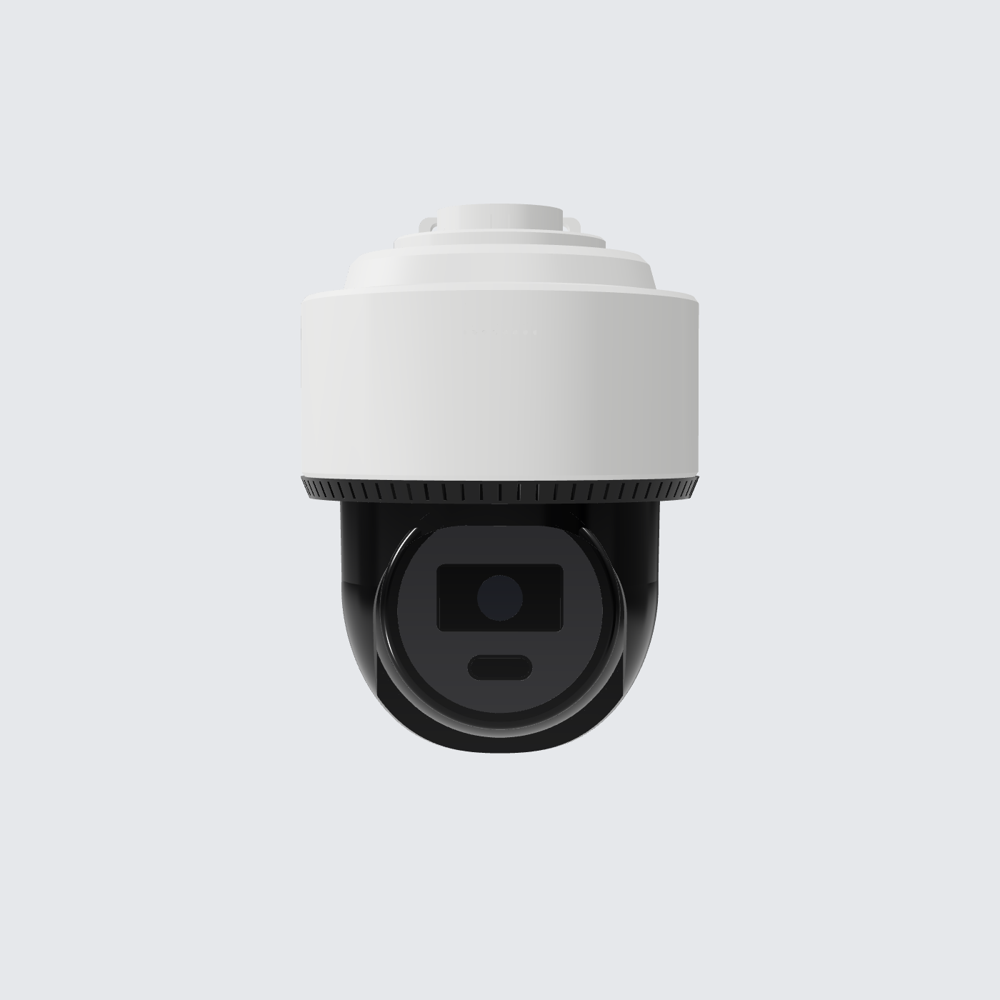

# Kepala Tiang CCTV: 4× Hikvision DS-2DE2C400MWG-E

Model 3D parametrik (CadQuery, solid B-rep, **tanpa mesh**). File STEP bisa langsung dibuka di Fusion 360, FreeCAD, SolidWorks, atau Onshape.


| Depan | Bawah | Atas | Isi box |
|---|---|---|---|
|  |  |  |  |

| Kamera (iso) | Kamera (depan) |
|---|---|
|  |  |

## File

| File | Isi |
|---|---|
| `cctv_pole_head.py` | Sumber parametrik. Semua dimensi ada di bagian `Parameters` |
| `out/cctv_pole_head_assembly.step` | Assembly lengkap, sudah berwarna |
| `out/parts/*.step` | Kolom inti, tub box, tutup box, kanopi, dan kamera |
| `renders/` | Gambar preview |

Untuk generate ulang:

```bash
pip install cadquery
python cctv_pole_head.py
```

## Kamera

Kamera dimodelkan dari **gambar dimensi di datasheet resmi** (`DS-2DE2C400MWG-E_Datasheet_20250115.pdf`):

| Dimensi | Datasheet | Model |
|---|---|---|
| Kedalaman, termasuk bracket | 163.9 | 163.9 |
| Diameter | 131.9 | 131.8 |
| Tinggi, termasuk bracket | 185.8 | 185.8 |
| Tinggi badan (tanpa bracket) | 162.3 | 162.3 |
| Pola lubang plat dinding | 47 × 57 | 47 × 57 |

Bentuknya mengikuti aslinya:
- housing atas putih dengan cap meruncing, termasuk titik-titik grill speaker
- ring ventilasi hitam
- kubah pan hitam dengan bukaan di depan
- kepala tilt dengan ring muka, jendela lensa, dan jendela lampu hybrid
- bracket dinding (plat 61 × 71 mm dan lengan)

Detail kecil diskalakan dari gambar yang sama, toleransinya sekitar ±1 mm.

## Susunan

1. **Kanopi melayang**: 262 × 262 mm, tebal tepi 5 mm dengan underside chamfer (knife-edge), kemiringan 4 arah yang landai, dan alur tetes air di bawahnya. Posisinya melayang 8 mm di atas tutup box, ditopang standoff tersembunyi, supaya panas dari tutup bisa keluar dan air tidak tertahan.
2. **Box controller monolit**: 226 × 226 × 122 mm. Sudut vertikal di-chamfer 10 mm, bagian bawah meruncing 45° ke arah kolom. Ada shadow gap 2 mm antara tub dan tutup, plus light bar status amber tipis di tiap sisi. Box tertutup rapat tanpa lubang ventilasi, target IP65.
   - **Isi box:** PSU 12 V 10 A (envelope 159 × 97 × 30, kelas LRS-150-12), Orange Pi 5 Plus dengan heatsink, switch gigabit 8 port (envelope 158 × 101 × 25) di rak di atas PSU, serta terminal block/fuse. Semua dipasang di backplate yang diangkat di atas zona chamfer bawah.
3. **Kolom inti**: 100 × 100 mm, dipasang di atas tiang 80 × 80 dan dikunci 8 baut socket flush. **Plat dinding kamera dibaut langsung ke 4 sisi kolom**, memakai pola lubang asli 47 × 57. Di belakang tiap plat ada lubang kabel, jadi kabel kamera masuk ke kolom lalu naik ke box tanpa terlihat dari luar.
4. **4 kamera**: tiap kamera menghadap satu sisi, simetris 90°. Sumbu kamera berada 148 mm dari sumbu tiang.

Ukuran keseluruhan kepala tiang: **428 × 428 mm**. Bagian tertinggi 190 mm di atas ujung tiang, bagian terendah (bawah kamera) 146 mm di bawahnya.

## Catatan

- Envelope switch memakai ukuran desktop 8 port yang umum. Kalau pakai switch industrial atau model yang lebih kecil, ganti `SWITCH` di parameter.
- Daya: kamera 12 VDC, maksimal 9 W per kamera (sumber: datasheet). Total 4 kamera + Orange Pi 5 Plus + switch kira-kira 60–70 W, masih aman untuk PSU 120 W.
