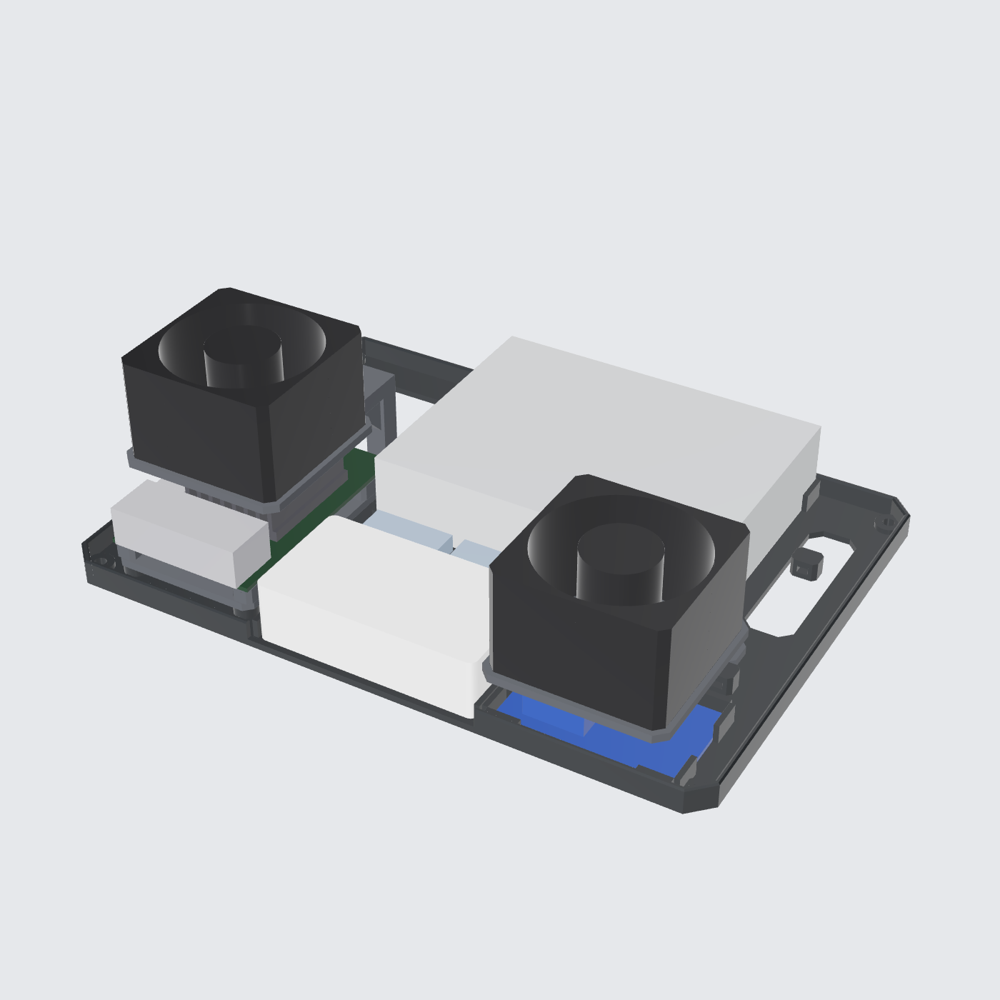
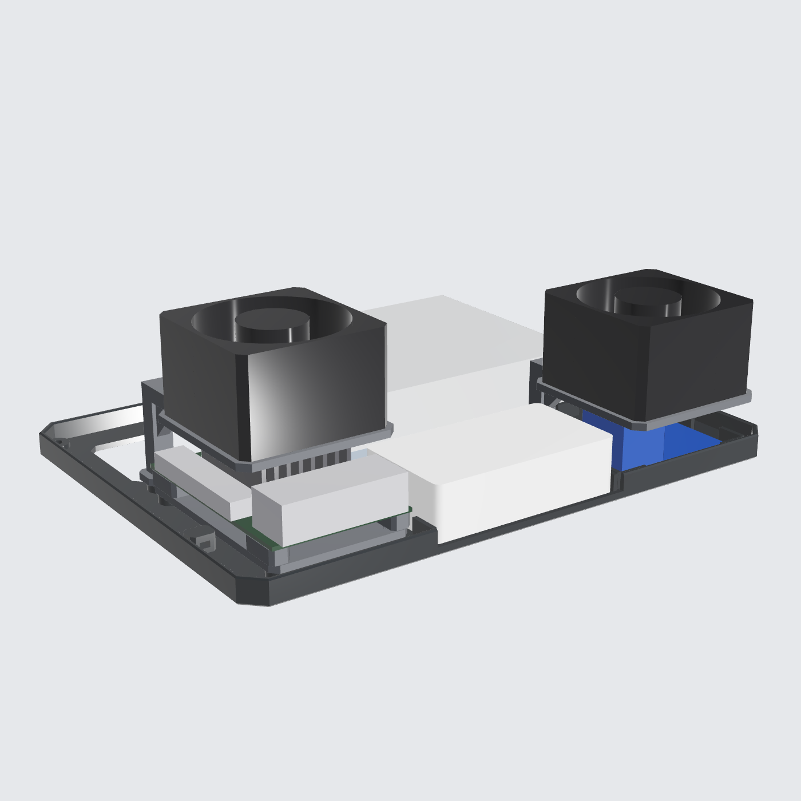
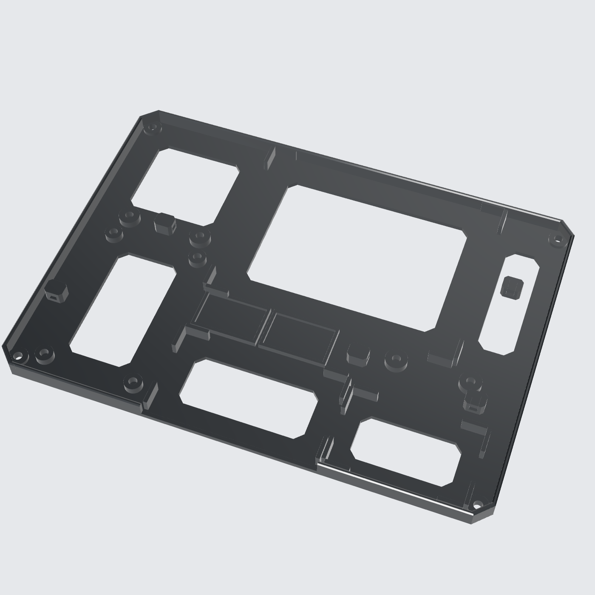

# Controller Bench: Open-Frame (Cetak Paling Cepat)

Pelat dasar terbuka untuk menguji elektronik secepatnya. Model parametrik CadQuery, berupa STEP solid tanpa mesh. Tidak ada dinding atau tutup, jadi semua port mudah dijangkau.

| Depan | Pelat saja |
|---|---|
|  |  |

## Part cetak (`out/print/`)

| Part | Ukuran | Orientasi cetak |
|---|---|---|
| `base_plate.step` | 245 × 177 × 10 | Datar |
| `opi_tray.step` | 57.5 × 89 × 9 | Datar |
| `fan_bracket_opi.step` | 64 × 90 × 39 | **Terbalik** (frame kipas di bed) |
| `fan_bracket_buck.step` | 64 × 78 × 27 | **Terbalik** (frame kipas di bed) |

**Total sekitar 160 g PLA.** Di Bambu Lab A1 cukup **2 plate**:

| Plate | Isi | Nozzle 0.4 (0.20 Standard) | Nozzle 0.6 |
|---|---|---|---|
| 1 | base_plate | ~2 jam | ~1.3 jam |
| 2 | opi_tray + 2 fan bracket | ~1 jam | ~0.7 jam |
| **Total** | | **~3 jam** | **~2 jam** |

Ini perkiraan dari volume model. Angka pastinya muncul setelah di-slice. Setting: 3 dinding, infill 15 %, tanpa support.

## Isi

- **Orange Pi 5 Ultra** di tray slot (sama dengan versi full).
- **Kipas 1** di atas Orange Pi, meniup ke bawah, 2.4 mm di atas heatsink.
- **Kipas 2** di atas buck converter, meniup ke bawah. Buck 5 V 5 A ikut panas.
- **TP-Link LS1005:** sisi port depan dibiarkan kosong supaya colokan RJ45 bebas.
- **PSU 12 V** rebahan, ditahan cradle sudut.
- **2× WAGO 221-415** di kantong.
- **5 anchor zip-tie** untuk merapikan kabel.
- **4 lubang M4** di sudut untuk dibaut ke meja atau papan. Bisa juga pakai kaki karet tempel.
- **Bagian pelat yang tidak menopang apa-apa dibolongi**, supaya cepat dicetak dan udara bisa lewat dari bawah.

Posisi semua komponen **sama persis** dengan `../controller-box-proto`, jadi kabel yang sudah dirakit di sini bisa langsung dipindah ke box prototipe.

Cek otomatis `Check: OK`: tidak ada komponen yang bertabrakan, dan port Orange Pi, port switch, serta terminal PSU tidak terhalang.

## Hardware

| Lokasi | Item |
|---|---|
| Tray Orange Pi | 4× insert M3 + M3 × 8, lalu M2.5 untuk board |
| Kaki bracket kipas | 4× insert M3 + M3 × 8 |
| Kipas ke bracket | 8× M3 × 45 + mur |
| Switch, buck, PSU | Double tape atau zip-tie |

**Perhatian:** PSU 12 V punya terminal AC yang terbuka. Di versi open-frame ini, jangan sentuh terminalnya saat listrik menyala, dan pasang penutup terminal bawaan PSU kalau ada.
