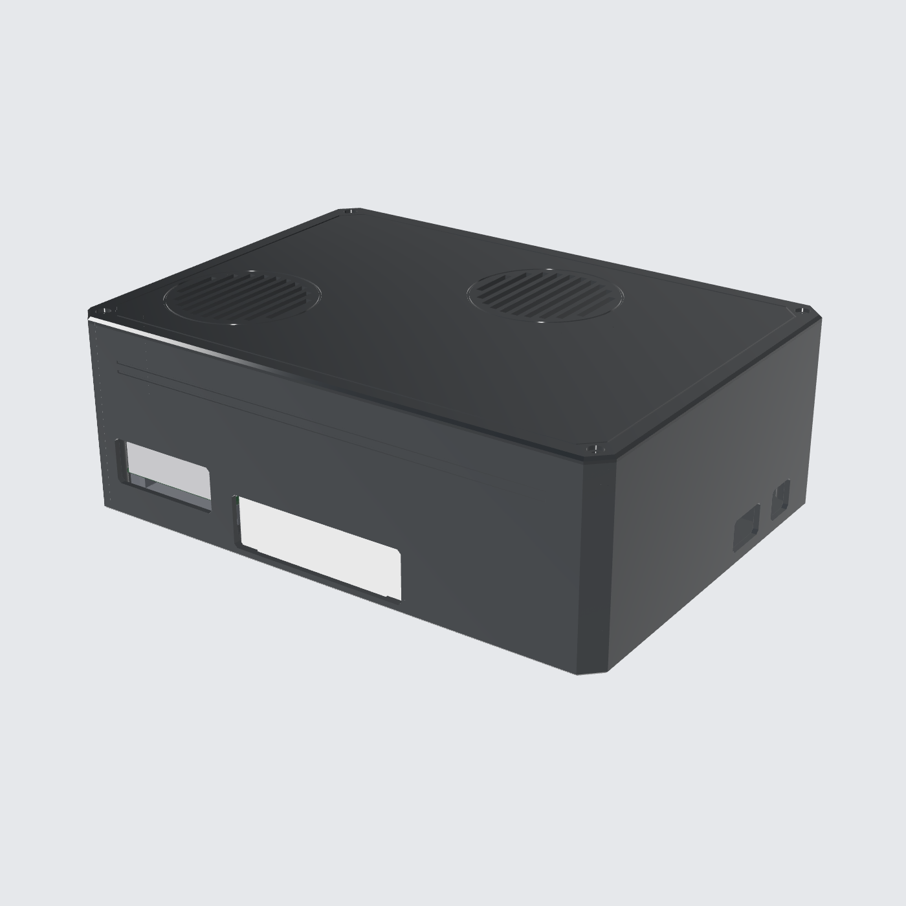
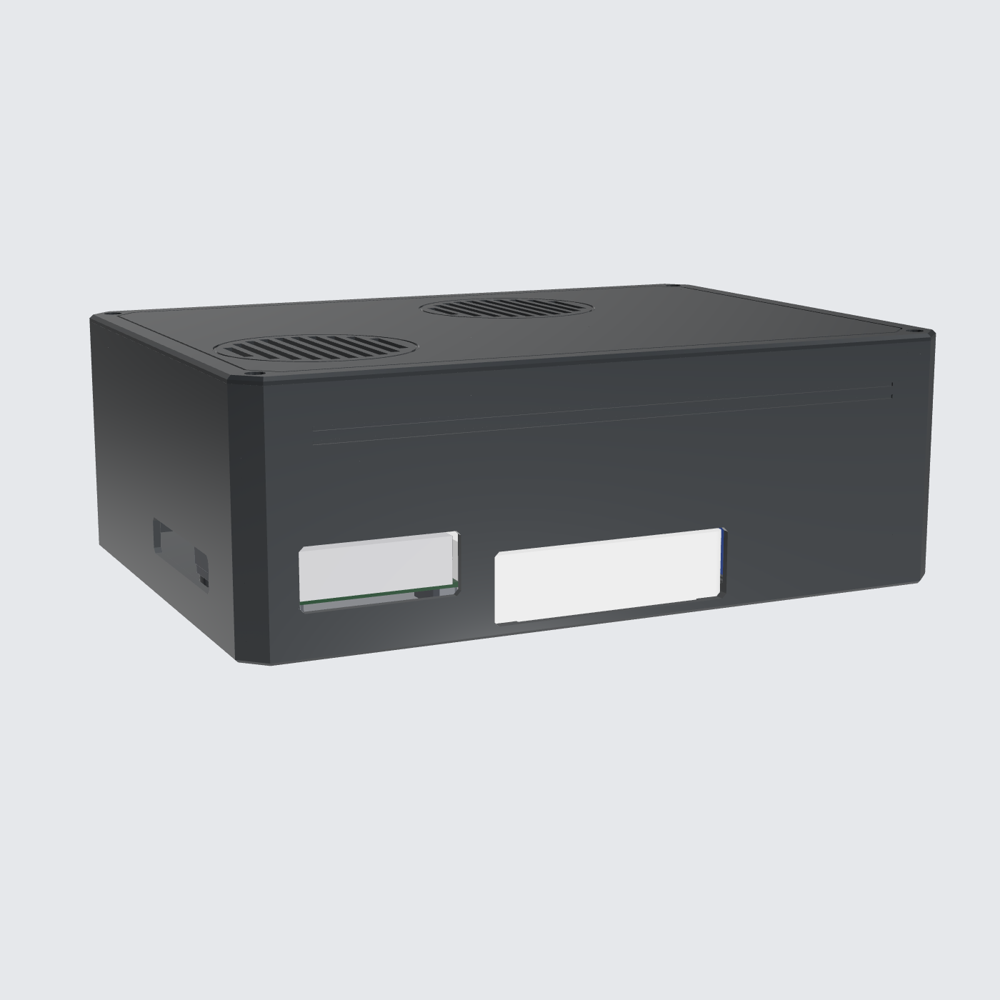
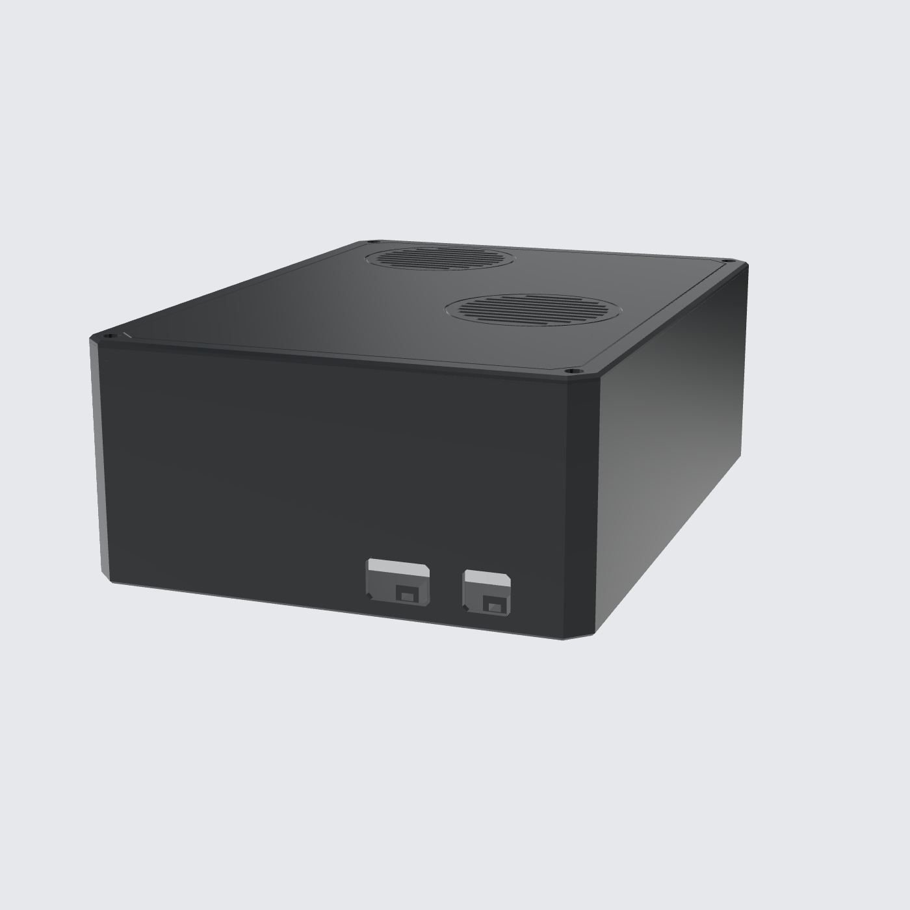
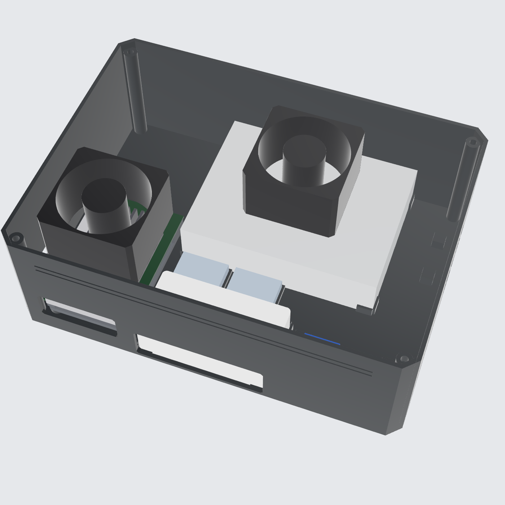
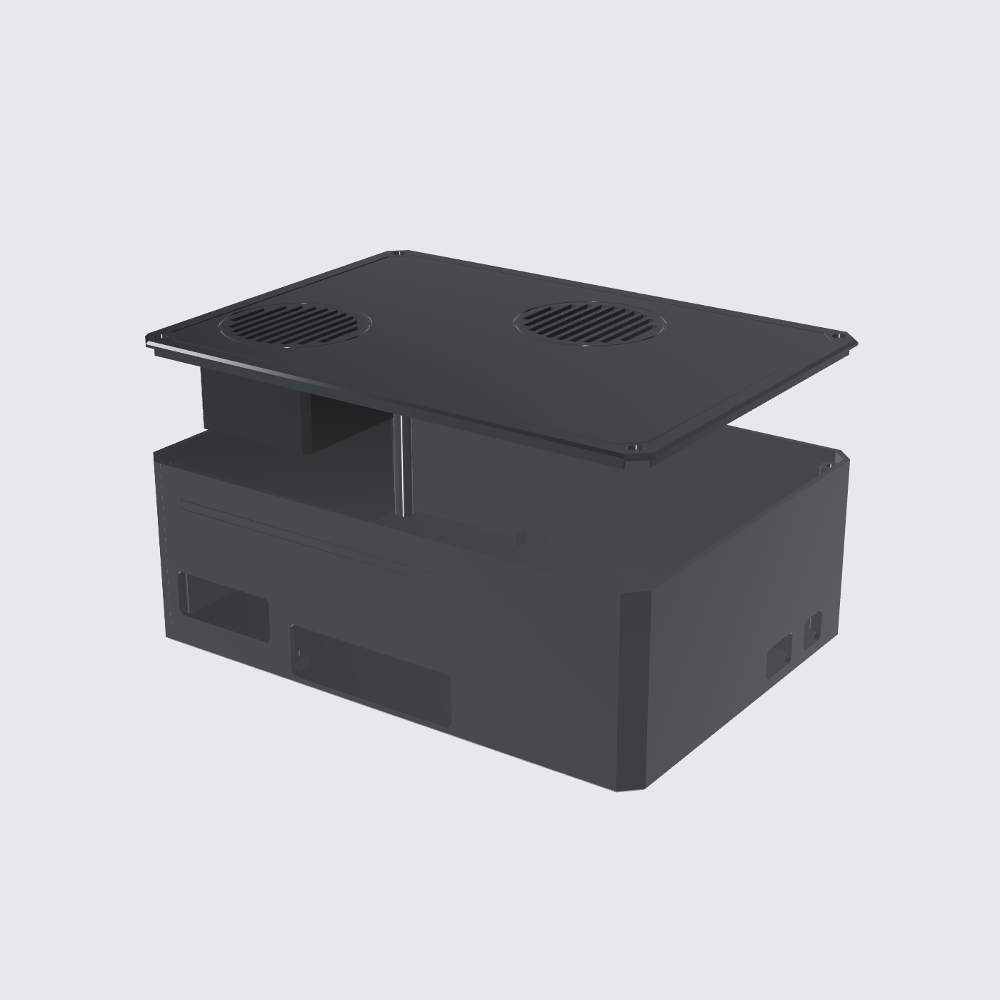

# Controller Box: Prototipe (Cetak Cepat)

Versi simpel untuk uji elektronik di meja atau di dalam ruangan. Model parametrik CadQuery, berupa STEP solid tanpa mesh.

| Port depan | Slot kabel kanan | Isi | Tutup + kipas |
|---|---|---|---|
|  |  |  |  |

## File

| File | Isi |
|---|---|
| `proto_box.py` | Sumber parametrik |
| `out/print/base.step` | **Cetak:** badan box |
| `out/print/lid.step` | **Cetak:** tutup (kipas digantung di sini) |
| `out/print/opi_tray.step` | **Cetak:** tray Orange Pi (sama dengan versi full) |
| `out/proto_box_assembly.step` | Assembly dengan komponen |
| `out/proto_box_preview.glb` | Preview 3D |

## Desain

- **Ukuran:** 245 × 177 × 84 mm (dengan tutup).
- **PSU rebahan** di belakang, supaya box pendek.
- **Kipas 1** di atas Orange Pi, meniup udara **masuk** ke heatsink. Jarak kipas ke heatsink 5 mm.
- **Kipas 2** di atas PSU, menyedot udara **keluar**. Udara mengalir dari kipas 1, lewat Orange Pi, lalu keluar lewat kipas 2.
- Kedua kipas dibaut ke **bawah tutup**, jadi badan box tidak punya dudukan kipas dan lebih cepat dicetak.

### Jalur kabel keluar

| Lubang | Lokasi | Untuk |
|---|---|---|
| Jendela port Orange Pi (sisi pendek) | Depan kiri | USB 3.0/2.0, LAN |
| Jendela port Orange Pi (sisi panjang) | Dinding kiri | USB-C, HDMI out/in, audio |
| Jendela port switch | Depan tengah | 5× RJ45 + DC. **Kabel kamera dicolok langsung dari luar** |
| Slot AC IN | Kanan belakang | Kabel listrik ke PSU, plus zip-tie strain relief di dalam |
| Slot DC OUT | Kanan | 12 V keluar ke kamera, plus zip-tie strain relief |

Jalur dari setiap port dan slot ke luar **dicek otomatis** (`Check: OK`).

**Catatan:** posisi port Orange Pi 5 Ultra di model ini mengikuti asumsi yang sama dengan versi full. Cek di board Anda.

## Cetak

| Part | Ukuran | Orientasi | Volume |
|---|---|---|---|
| base | 245 × 177 × 82 | Lantai di bed | 257 cm³ |
| lid | 245 × 177 × 6.4 | Permukaan atas di bed | 102 cm³ |
| opi_tray | 57.5 × 89 × 9 | Datar | 14 cm³ |

- Dinding 2.4 mm. Pakai **3 dinding (nozzle 0.4) atau 2 dinding (nozzle 0.6)**, infill 15 %.
- Total sekitar **450 g PLA**. Perkiraan waktu: **sekitar 9–10 jam** (nozzle 0.4, layer 0.2) atau **sekitar 5–6 jam** (nozzle 0.6, layer 0.28) di printer kelas Bambu.
- Tidak perlu support. Bagian atas jendela port berupa bridge pendek (maksimal 82 mm).

### Hardware

| Lokasi | Item |
|---|---|
| Tutup ke badan | 4× heat-set insert M3 + 4× M3 × 8 button head |
| Kipas ke tutup | 8× M3 × 40 self-tapping (masuk ke boss di bawah tutup) |
| Tray Orange Pi | 4× insert M3 + M3 × 8, lalu M2.5 untuk board |
| Switch, buck, PSU | Duduk di cradle sudut. Kunci dengan double tape atau zip-tie |

**Tidak tahan air.** Grill kipas ada di atas tutup. Untuk pemasangan di luar, pakai versi full (`../controller-box`).
