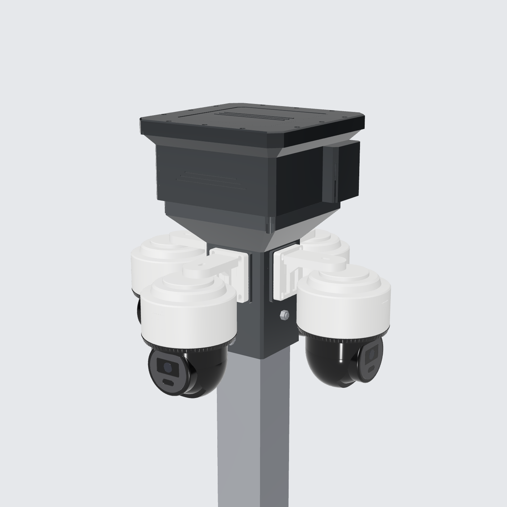
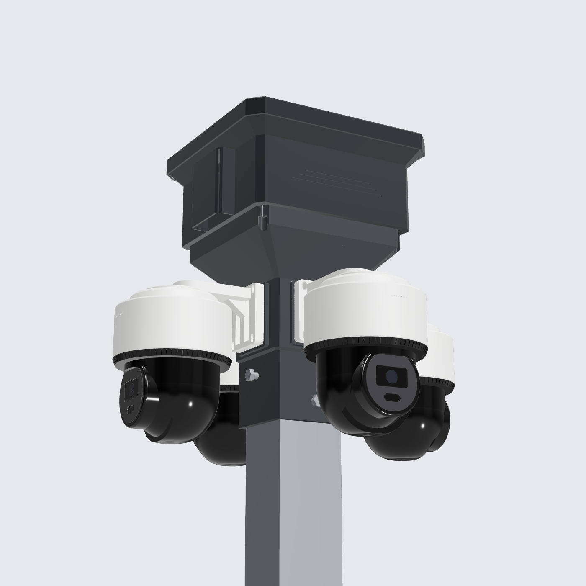
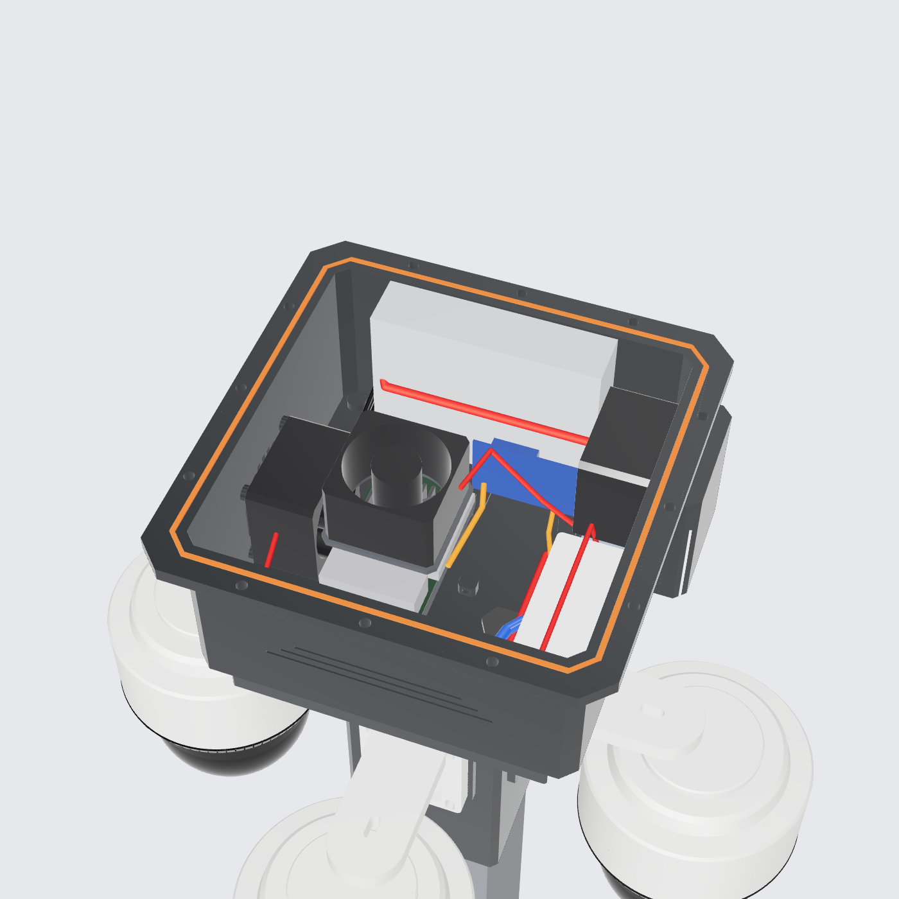
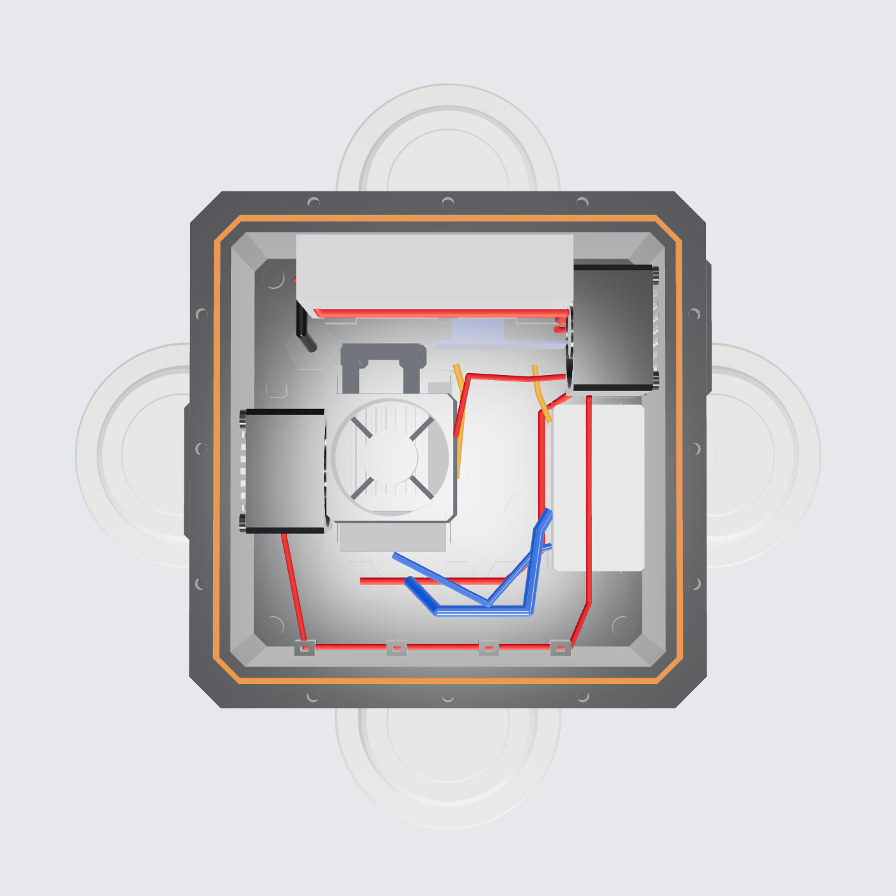

# Controller Box + Hub Kamera di Atas Tiang (3D Print)

Model parametrik CadQuery, solid B-rep **tanpa mesh**. File STEP bisa langsung dibuka di Bambu Studio, OrcaSlicer, PrusaSlicer, Fusion 360, atau FreeCAD. File `.glb` hanya untuk preview 3D.

| Bawah | Isi | Layout atas |
|---|---|---|
|  |  |  |

## File

| File | Isi |
|---|---|
| `controller_box.py` | Sumber parametrik. Semua ukuran ada di bagian `Parameters` |
| `out/controller_box_on_pole_assembly.step` | **Assembly utama**, **Y-up** (Fusion 360, SolidWorks, Blender). Pivot di tengah dasar |
| `out/controller_box_on_pole_assembly_Zup.step` | Assembly yang sama, **Z-up** (FreeCAD, Onshape, Inventor, Bambu Studio). Pivot di tengah dasar |
| `out/controller_box_on_pole_preview.glb` | Preview 3D (bisa dibuka di HP/PC) |
| `out/print/base.step` | **Cetak:** badan box |
| `out/print/lid.step` | **Cetak:** tutup |
| `out/print/gasket_tpu.step` | **Cetak (TPU):** gasket |
| `out/print/opi_tray.step` | **Cetak:** tray Orange Pi |
| `out/print/opi_fan_bracket.step` | **Cetak:** dudukan kipas di atas Orange Pi |
| `out/print/camera_hub.step` | **Cetak:** hub tiang + dudukan 4 kamera + ruang kabel |
| `out/print_stl/*.stl` | Part yang sama dalam format STL, **sudah diputar ke orientasi cetak** (lid dan bracket terbalik) dan berada di Z=0 |

## Susunan dari atas ke bawah

1. **Box controller:** interior 200 × 200 × 110 mm, dibaut ke hub dengan 4 baut M5. Baut masuk dari bawah ke heat-set insert di dalam boss lantai. Lubangnya buntu, jadi lantai box tetap kedap.
2. **Ruang kabel (chamber):** bagian atas hub, 168 × 168 mm. Semua cable gland di lantai box ada di dalam ruang ini, jadi terlindung dari hujan langsung.
3. **Flare 45°:** bagian hub yang melebar dari sleeve ke chamber. Bisa dicetak tanpa support.
4. **Dudukan kamera:** 4 pad di 4 sisi sleeve, masing-masing dengan **4 heat-set insert M4** sesuai pola lubang plat kamera (47 × 57). Di belakang tiap plat ada **lubang kabel Ø22**, jadi kabel kamera langsung masuk ke dalam hub lalu naik ke chamber.
5. **Sleeve:** di zona kamera dinding **10 mm** (ditambah pad 5 mm = 15 mm di area baut kamera); bagian bawah yang masuk ke tiang 7 mm (ditopang tiang). Sleeve dimasukkan ke tiang **80 × 80** sedalam 80 mm, dan duduk di atas ujung tiang lewat 4 tonjolan penahan.
6. **Kunci ke tiang:** **2 baut M8 tembus** (hub dan tiang dibor Ø8.5). Satu arah X di 25 mm dan satu arah Y di 58 mm di bawah ujung tiang, pakai mur nyloc dan ring.

Tinggi total di atas ujung tiang 263 mm. Bentang kamera sekitar 440 mm.

## Port tidak terhalang

Setiap baris port punya **ruang kosong 30 mm** di depannya, dan ruang ini **dicek otomatis** setiap kali model di-generate. Kalau ada yang menghalangi, script akan menampilkan pesan `PORT BLOCKED`.

| Port | Arah | Ruang kosong |
|---|---|---|
| Orange Pi, sisi pendek (USB 3.0/2.0, LAN 2.5G) | Menghadap depan | 30 mm, cukup untuk colokan + tekukan kabel |
| Orange Pi, sisi panjang (USB-C power, HDMI out/in, audio) | Menghadap tengah box | 30 mm |
| Switch LS1005 (5× RJ45 + DC) | Menghadap tengah box | 30 mm |
| Terminal PSU | Ujung kiri | 25 mm |

**Catatan:** posisi persis port Orange Pi 5 Ultra (port mana di sisi mana) belum ada di dokumen publik yang saya temukan. Model mengikuti tata letak ala Raspberry Pi: USB/LAN di satu sisi pendek, HDMI/USB-C di satu sisi panjang. **Cek di board Anda.** Kalau ternyata terbalik, tray bisa diputar 180°, dan posisinya bisa diubah di `OPI_TRAY`.

## Isi box

| Komponen | Posisi |
|---|---|
| PSU 12 V 128 × 97.5 × 30 | Berdiri di dinding belakang, terminal di ujung kiri |
| Orange Pi 5 Ultra | Kiri-tengah, di tray slot (jarak lubang bisa disetel 58–82 × 49–50) |
| Kipas atas 60 × 60 × 37.5 | Tepat di atas Orange Pi, meniup ke bawah. Tiang bracket ada di **belakang** board (sisi tanpa port) |
| Kipas intake 60 × 60 × 37.5 | Dinding kiri, meniup ke Orange Pi |
| Kipas exhaust 60 × 60 × 37.5 | Dinding kanan atas |
| TP-Link LS1005 | Sisi kanan, port menghadap ke dalam |
| Buck 12 V → 5 V (min. 5 V 6 A) | Berdiri di belakang Orange Pi |
| 2× WAGO 221-415 | Di bawah kipas exhaust |
| Gland | 4× M16 kamera (depan), 1× M16 cadangan, 1× M20 AC (dari dalam tiang) |

Uplink internet lewat **Wi-Fi Orange Pi**. Box plastik tidak menghalangi sinyal.

## Anti air

- **Tutup:** tongue-and-groove + **gasket TPU** + skirt yang menutupi flange dari luar, dikencangkan 12 baut M4.
- **Kipas:** udara lewat **rain cowl yang terbuka ke bawah**, dengan slot filter.
- **Kabel:** semua masuk dari bawah lewat gland, di dalam chamber hub.
- Karena ada kipas, box ini **tahan hujan dan cipratan (sekitar IPX4)**, bukan kedap total.

## Panduan cetak (bed 256 × 256)

| Part | Ukuran cetak | Orientasi | Setting |
|---|---|---|---|
| base | 250 × 238 × 103 | Lantai di bed | 4 dinding, 25 % gyroid, 5 lapis atas/bawah |
| lid | 244 × 244 × 21 | Permukaan atas di bed | Sama dengan base |
| camera_hub | 192 × 192 × 227 | Sleeve di bed (tegak) | **6 dinding, 40–50 % gyroid**. Part ini menahan 4 kamera (2.4 kg) |
| opi_fan_bracket | | Terbalik (frame di bed) | 4 dinding, 40 % |
| opi_tray | | Datar | 3 dinding |
| gasket_tpu | | Datar | TPU 95A, 100 % |

- **Tidak perlu support.** Semua overhang sudah dibuat 45°, dan lubang horizontal (baut M8, lubang kabel kamera) berbentuk teardrop.
- **Material:** PLA boleh untuk uji pasang. Untuk pemakaian di luar, terutama **camera_hub** yang menahan beban, pakai **PETG atau ASA**, karena PLA bisa melunak di sekitar 55–60 °C dan pelan-pelan berubah bentuk menahan beban.

### Heat-set insert dan baut

| Lokasi | Insert | Baut |
|---|---|---|
| Flange box (tutup) | 12× M4 | M4 × 16 |
| Kipas dinding | 8× M3 | M3 × 45 |
| Kipas atas | | 4× M3 × 45 + mur |
| Tray + kaki bracket | 6× M3 | M3 × 8 |
| Lantai box (ke hub) | 4× M5 (dari bawah) | M5 × 20 + ring |
| Pad kamera di hub | 16× M4 | M4 × 12 |
| Kunci ke tiang | | 2× M8 × 110 + mur nyloc + ring |

## Daya (perkiraan)

| Beban | Daya |
|---|---|
| Orange Pi 5 Ultra | 10–20 W |
| LS1005 | 2 W |
| 3 kipas 60 × 38 | 3–15 W |
| 4 kamera (12 V, maks. 9 W) | 36 W |
| **Total** | **sekitar 50–75 W, jadi PSU 12 V minimal 8 A** |
