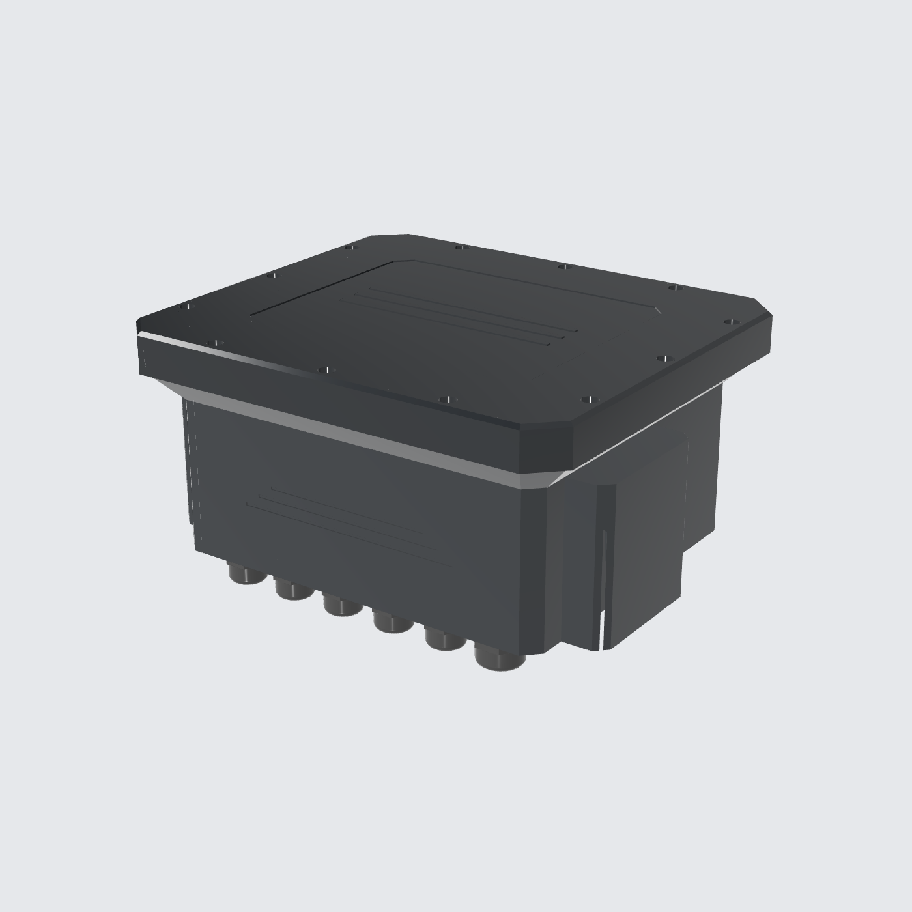
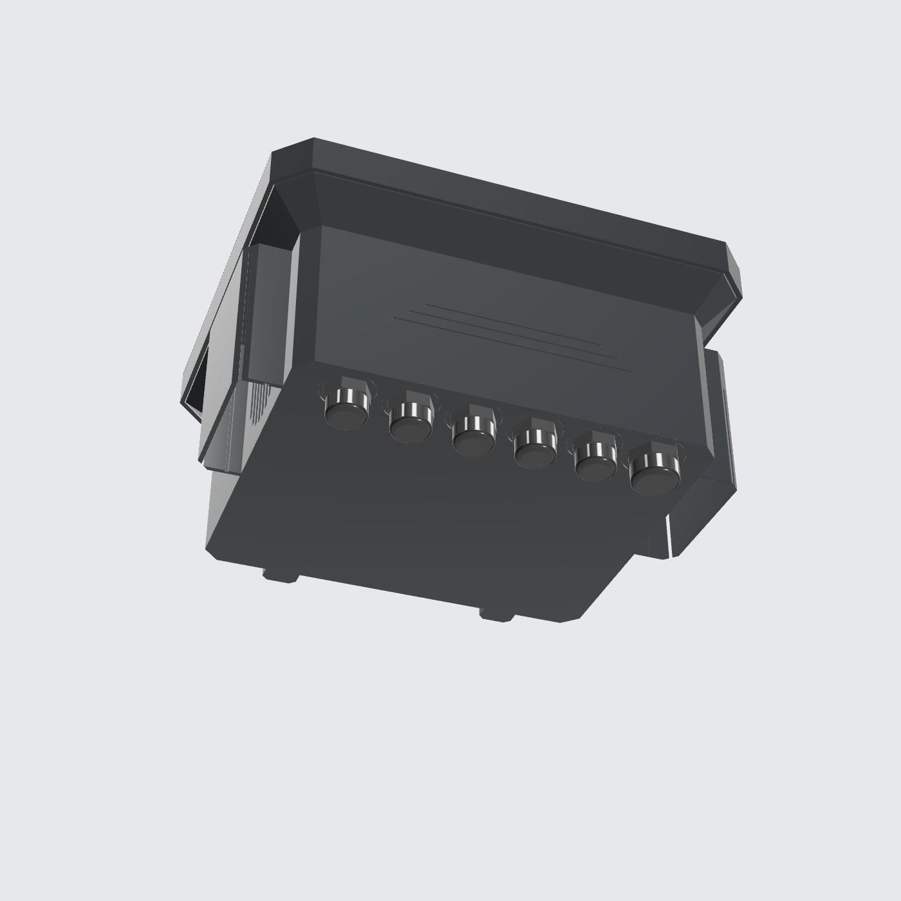
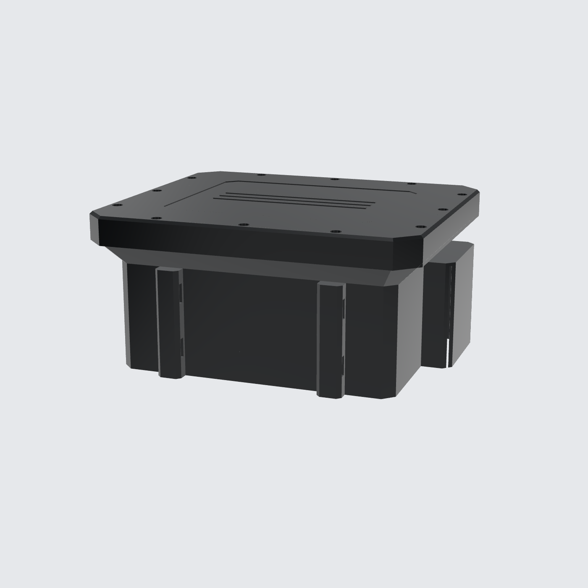
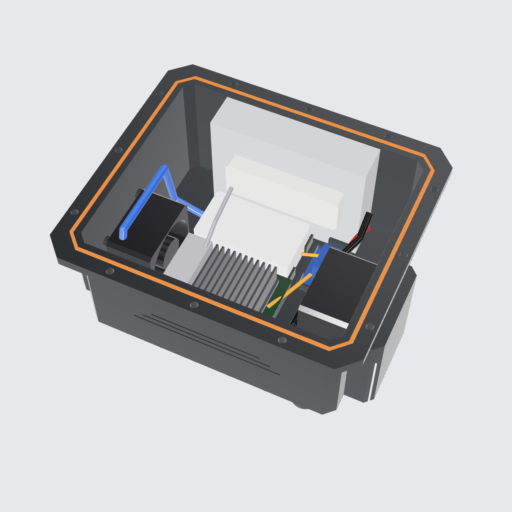
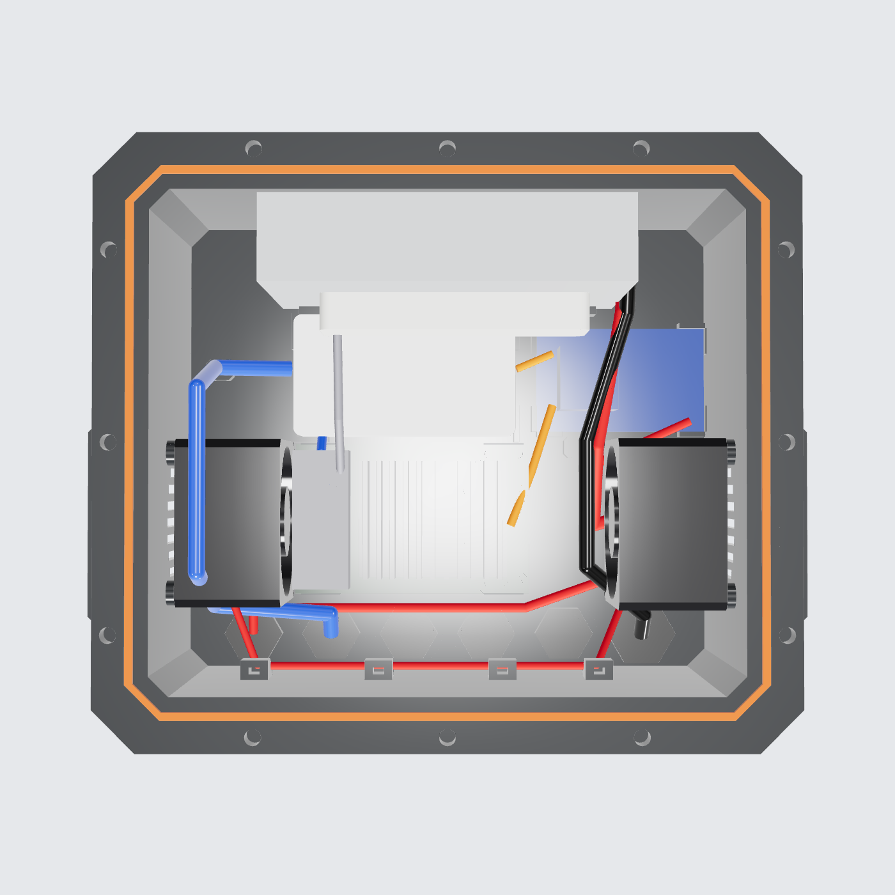
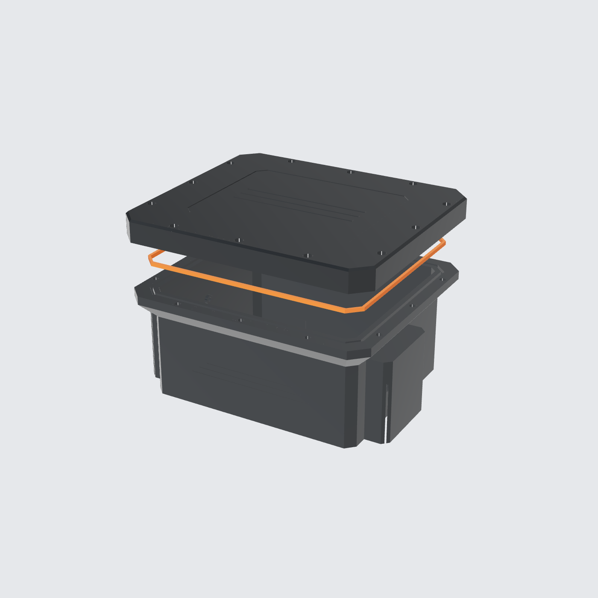

# Controller Box Anti Air (3D Print)

Model parametrik CadQuery, solid B-rep **tanpa mesh**. File STEP bisa langsung dibuka di Bambu Studio, OrcaSlicer, PrusaSlicer, Fusion 360, atau FreeCAD.

| Bawah (gland) | Belakang (mount) | Isi | Layout atas | Part cetak |
|---|---|---|---|---|
|  |  |  |  |  |

## File

| File | Isi |
|---|---|
| `controller_box.py` | Sumber parametrik. Semua ukuran ada di bagian `Parameters` |
| `out/controller_box_assembly.step` | Assembly lengkap: box, komponen, dan jalur kabel |
| `out/print/base.step` | **Cetak:** badan box |
| `out/print/lid.step` | **Cetak:** tutup |
| `out/print/gasket_tpu.step` | **Cetak (TPU):** gasket |
| `out/print/opi_tray.step` | **Cetak:** tray Orange Pi |

## Ukuran

| | |
|---|---|
| Interior | 200 × 170 × 110 mm |
| Base (luas cetak) | 250 × 208 × 103 mm |
| Lid (luas cetak) | 244 × 214 × 21 mm |
| **Bed printer minimum** | **256 × 256 mm** (Bambu A1/P1/X1, Prusa XL, dll.) |

## Isi box

| Komponen | Ukuran | Posisi |
|---|---|---|
| PSU 12 V | 128 × 97.5 × 30 | Berdiri di sisi panjangnya, menempel dinding belakang. Dijepit 2 U-channel di lantai dan 2 pad penahan di bawah tutup (tambahkan foam 2 mm) |
| Orange Pi 5 Ultra | 89 × 57 | Di atas **tray dengan lubang slot**, jadi posisi lubang board bisa disetel (jarak lubang 58–82 × 49–50 mm). Posisi lubang board ini belum dipublikasikan, cek di board aslinya |
| TP-Link LS1005 | 83.6 × 45.7 × 22.8 | Cradle 4 sudut, diikat zip-tie |
| Buck converter 12 V → 5 V | sekitar 65 × 40 × 22 | Cradle 4 sudut. Untuk Orange Pi (USB-C 5 V) dan switch (5 V 0.6 A). **Pakai minimal 5 V 6 A** |
| 2× WAGO 221-415 | | Kantong di lantai, untuk distribusi 12 V (+) dan (−) |
| Modem USB 4G LTE (uplink) | sekitar 95 × 32 × 13 | Ditempel velcro di muka depan PSU, disambung ke Orange Pi dengan kabel USB extension pendek. Antena internal modem tetap dapat sinyal karena box-nya plastik |
| 2× kipas 60 × 60 × 37.5 | | **Intake** kiri bawah meniup ke Orange Pi. **Exhaust** kanan atas. Aliran udara menyilang diagonal melewati semua komponen |

## Anti air

1. **Tutup:** sambungan tongue-and-groove dengan **gasket TPU**, ditambah **skirt** tutup yang menutupi flange dari luar. Jadi ada dua lapis penghalang, dikencangkan 12 baut M4.
2. **Kipas:** udara keluar-masuk lewat **rain cowl** yang hanya terbuka **ke bawah**. Air hujan tidak bisa masuk langsung. Di dalam cowl ada slot untuk lembaran filter (stainless mesh atau busa filter, tebal 1.6 mm) supaya serangga dan debu tertahan.
3. **Kabel:** semua masuk dari **lantai** lewat cable gland. Air yang mengalir di kabel tidak akan menetes masuk.

Catatan jujur: karena ada kipas, box ini **tahan hujan dan cipratan (sekitar IPX4)**, bukan kedap total (IP67). Pasang dengan cowl menghadap ke bawah, seperti di model.

## Jalur kabel

Semua kabel masuk dari lantai depan. Gland dari kiri ke kanan:

| Gland | Ukuran | Fungsi |
|---|---|---|
| 1–4 | M16 | Kamera 1–4 (Ethernet + 12 V). Pakai insert 2 lubang |
| 5 | M16 | Uplink/cadangan |
| 6 | M20 | AC masuk ke PSU |

Rute di dalam box (warna kabel sesuai preview):

- **AC (hitam):** gland M20, naik melewati buck, lalu ke terminal AC PSU di sisi kanan.
- **12 V (merah):** dari PSU ke WAGO. Dari WAGO bercabang ke:
  - kipas exhaust (dekat)
  - kipas intake (melalui jalur di dinding depan, diikat ke 4 anchor zip-tie)
  - input buck converter
  - kamera, keluar lewat gland 1–4
- **5 V (oranye):** dari buck ke USB-C Orange Pi dan ke jack DC switch.
- **Ethernet (biru):** dari gland kamera, naik di dinding kiri **di atas** kipas intake, lalu turun ke port switch. Orange Pi tersambung ke switch dengan kabel pendek.

- **USB (abu-abu):** dari Orange Pi ke modem 4G.

## Uplink internet

LS1005 hanya punya 5 port, dan semuanya terpakai oleh 4 kamera + Orange Pi. Karena itu uplink dibuat lewat **modem USB 4G di Orange Pi**:

- Orange Pi merekam keempat kamera ke **NVMe/SD lokal** (jadi NVR). Lewat 4G yang dikirim hanya event, notifikasi, dan live view saat dibuka. Kuota tetap hemat dan rekaman aman walaupun sinyal putus.
- Kalau semua kamera di-stream terus-menerus ke cloud, butuh upload sekitar 16 Mbps atau lebih. Itu boros kuota 4G.
- **Kalau di dekat tiang (kurang dari 100 m) ada internet kabel,** lebih baik pakai Ethernet. Ganti switch ke 8 port (ubah `SWITCH` di parameter) dan pakai gland 5 (cadangan) untuk kabel uplink.

## Panduan cetak

| Part | Orientasi | Material | Setting |
|---|---|---|---|
| base | Lantai di bed, bukaan ke atas | PLA dulu, nanti **ASA** atau PETG (lihat catatan PLA) | 0.2 mm, 4 dinding, infill 25 % gyroid, 5 lapis atas/bawah |
| lid | **Permukaan atas di bed** | Sama dengan base | Sama dengan base |
| gasket_tpu | Datar | TPU 95A | 100 % infill, kecepatan rendah |
| opi_tray | Datar | PETG/ASA | 3 dinding |

- **Tidak perlu support.** Semua overhang (flange, atap cowl, anchor) sudah di-chamfer 45°. Lubang grill kipas dibuat berupa slot vertikal, jadi tidak ada lengkungan besar yang menggantung.
- **Heat-set insert:**
  - 12× M4 (lubang Ø5.6, kedalaman 8) di flange untuk tutup
  - 8× M3 (Ø4.2) untuk kipas
  - 4× M3 untuk tray
- **Baut:** M4 × 16 untuk tutup (kepala masuk counterbore), M3 × 45 untuk kipas (menembus badan kipas 37.5 mm), dan M2.5 untuk Orange Pi di tray.
- **Setelah cetak,** lapisi sambungan gland dengan O-ring bawaan gland. Kalau pakai PETG, cat dengan cat UV-resistant untuk pemakaian outdoor.

## Catatan PLA

PLA **bisa dipakai untuk versi pertama**, misalnya untuk tes pas atau prototipe. Model tidak perlu diubah karena PLA lebih mudah dicetak daripada ASA. Tapi untuk dipasang permanen di luar, PLA punya tiga kelemahan:

1. **Melunak di sekitar 55–60 °C.** Box gelap yang dijemur matahari ditambah panas PSU bisa melewati suhu ini. Akibatnya box bisa melengkung, dan tekanan gasket jadi berkurang sehingga box tidak kedap lagi.
2. **Rapuh terkena UV** setelah beberapa bulan.
3. **Creep (berubah bentuk pelan-pelan)** di titik baut dan heat-set insert.

Kalau tetap memakai PLA di luar:
- Cetak warna **putih atau abu-abu muda**, jangan hitam, supaya suhunya bisa beberapa belas derajat lebih rendah.
- Pakai 5 dinding dan cat dengan cat semprot UV-resistant.
- Pasang di sisi tiang yang teduh.
- Ganti ke **ASA** (paling tahan outdoor) atau **PETG** (gampang dicari dan cukup bagus) begitu tersedia.

Gasket tetap dicetak pakai **TPU**.

## Pemasangan di tiang

Pakai **2 klem selang stainless** (hose clamp, lebar band sampai 14 mm, tebal sampai 4 mm). Band dimasukkan lewat slot di 2 rail belakang, ada 2 slot per rail, jadi bisa 2 klem (atas dan bawah). Jarak antar rail 102 mm. Tiang kotak sampai 100 mm (misalnya 80 × 80) masuk di antara rail dan menempel rata ke dinding box. Tiang bulat sampai sekitar Ø100 mm juga bisa. Pilih ukuran klem sesuai keliling tiang ditambah sekitar 40 mm. Pasang box dengan **gland menghadap ke bawah**.

## Daya (perkiraan)

| Beban | Daya |
|---|---|
| Orange Pi 5 Ultra | 10–20 W |
| LS1005 | 2 W |
| 2 kipas 60 × 38 | 2–10 W (tergantung model) |
| 4 kamera DS-2DE2C400MWG-E (dari box ini) | 4 × 9 W = 36 W |
| Modem USB 4G | 2–3 W |
| **Total** | **sekitar 50–70 W, jadi PSU 12 V minimal 6–8 A** |
